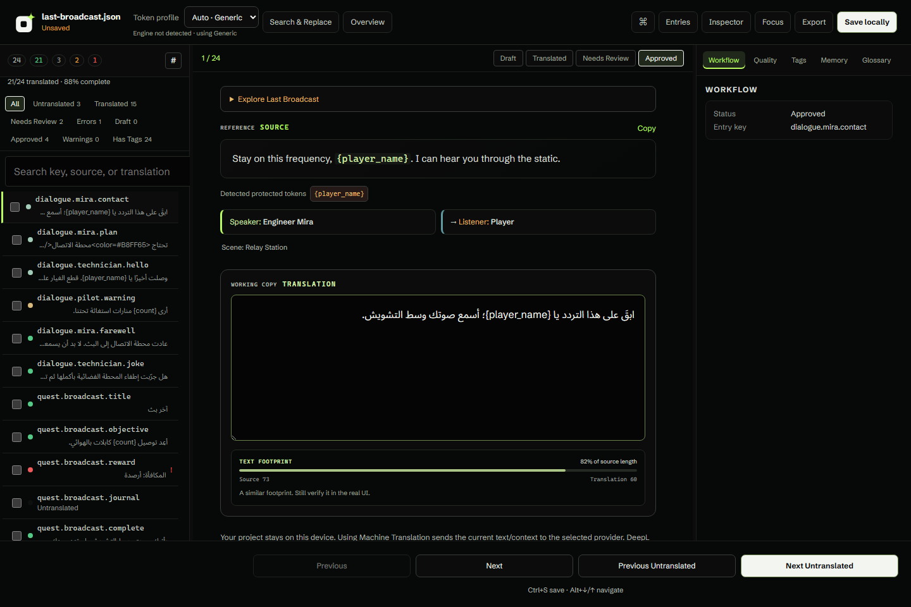
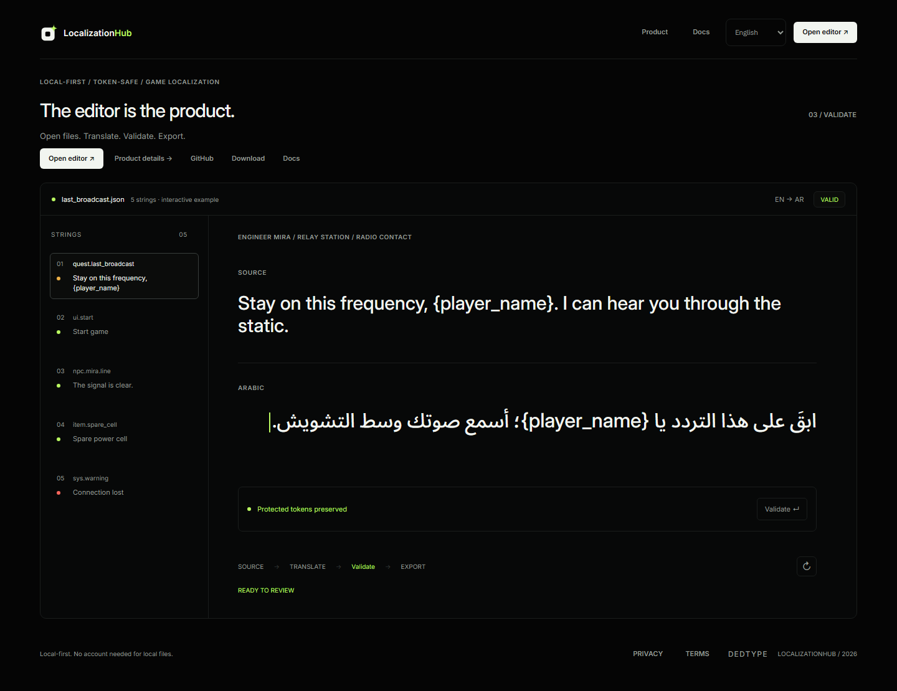

<p align="center">
  
</p>

<h1 align="center">LocalizationHub</h1>

<p align="center">A local-first workspace for game localization.<br>Translate with context. Protect game syntax. Review before you export.</p>

<p align="center">
  <a href="https://localizationhub.app/">Website</a> ·
  <a href="https://localizationhub.app/app/local?sample=last-broadcast">Try the editor</a> ·
  <a href="https://github.com/dedwrite/LocalizationHub/releases/latest">Windows download</a> ·
  <a href="https://localizationhub.app/reference">Documentation</a>
</p>



## Built for game translators

- **Context beside the text** — speaker, listener and scene information when present in the source.
- **Protected syntax** — placeholders, tags and engine-aware token checks stay visible while you translate.
- **Review tools** — workflow states, QA, glossary, Translation Memory, search and bulk actions.
- **Arabic and RTL** — English/Arabic interface with independent source and translation reading directions.
- **Local or shared** — work locally without an account, or choose Cloud Projects with role-based collaboration.
- **Game text extraction** — the Windows app scans supported Godot, Unreal and Unity resources without modifying the originals. [Compatibility and helper-tool requirements](docs/dev/v0.7-engine-compatibility.md).

Open JSON, CSV or gettext PO files, and save work as a LocalizationHub project (`.lhproj`). Browser, Desktop and Cloud workflows share the localization core.

## Get started

**In your browser:** [open the Last Broadcast sample](https://localizationhub.app/app/local?sample=last-broadcast), edit a translation, check its tokens and export. No account needed for local files.

**On Windows:** [download the public Windows x64 installer](https://localizationhub.app/download), with its version and SHA-256 checksum. No tester approval or GitHub sign-in is required. Other operating systems do not currently have verified packaged releases.

**With a team:** create an account, verify your email and use Cloud Projects. Owners, Editors and Viewers have server-enforced permissions.



## Your files, your choice

Local browser projects stay in that browser profile; browser storage is not a backup. Export important projects regularly. Cloud Projects upload when you choose Cloud, and external translation providers receive text when you request their services.

Game extraction is read-only. It is not game-resource injection, archive repacking or executable modification.

The Windows installer is **unsigned** and may trigger SmartScreen. Back up important projects before upgrading.

## Development

React · TypeScript · Tauri/Rust · Node.js · PostgreSQL

```sh
npm ci
npm run website:dev
```

For full setup, see [CONTRIBUTING.md](CONTRIBUTING.md), the [development map](docs/development.md) and [Desktop instructions](frontend/README.md). Use your own development database and ignored local configuration; never commit secrets or use production data for tests.

```sh
npm test
npm run website:build
npm run test:i18n
```

## Contribute and report security issues

Bug reports, synthetic fixtures, EN/AR improvements and focused pull requests are welcome. Read [CONTRIBUTING.md](CONTRIBUTING.md) and the [Code of Conduct](CODE_OF_CONDUCT.md). Report vulnerabilities privately through [SECURITY.md](SECURITY.md), not public issues.

## License

First-party code is [MIT licensed](LICENSE). Fonts, external extraction tools and dependencies retain their own licenses; see [Third-Party Notices](THIRD_PARTY_NOTICES.md). Workspace `private: true` flags prevent accidental npm publication, not public access to the code.

## Learn more

[Release notes](docs/releases/v0.9.10.md) · [Engine compatibility](docs/dev/v0.7-engine-compatibility.md) · [Token profiles](docs/dev/token-profiles.md) · [UI internationalization](docs/dev/ui-internationalization.md)

---

Made by [DEDTYPE](https://dedtype.com/) · [Release process](docs/releases/windows-release-process.md) · [Maintainer summary](docs/maintainer-summary.md) · [Privacy](https://localizationhub.app/privacy) · [Terms](https://localizationhub.app/terms)
